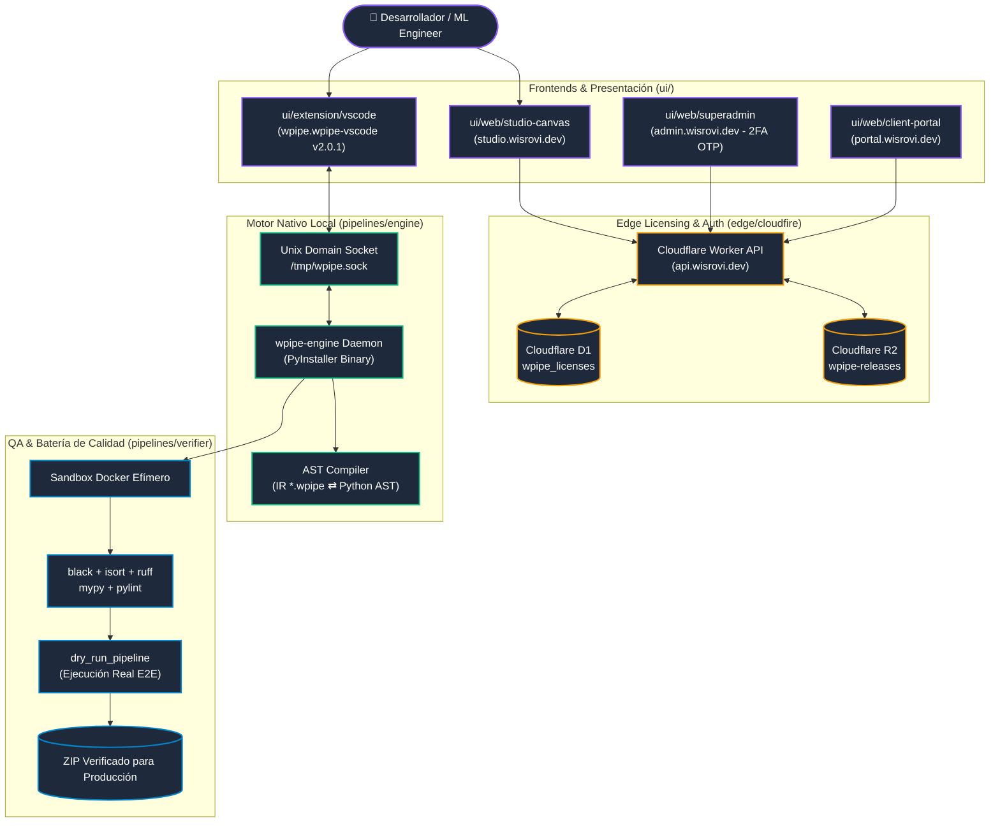

# WPipe Studio — Arquitectura Global y Modelo Mental

WPipe Studio es una plataforma SaaS multi-tenant diseñada para crear, orquestar y generar microservicios Python de producción basados en pipelines declarativos con `wpipe`, validados matemáticamente y empaquetados en contenedores Docker.

---

## 1. Taxonomía Canónica del Monorepo

Toda la estructura del repositorio está organizada siguiendo principios de responsabilidad única y cero carpetas sin `README.md`:

| Directorio | Propósito & Contenido |
|---|---|
| **`pipelines/engine/`** | Demonio local en segundo plano (`wpipe-engine`), compilado a binario nativo PyInstaller, interfaz IPC (`/tmp/wpipe.sock`), y motor de descompilación y compilación AST. |
| **`pipelines/verifier/`** | Orquestador de la batería de calidad (6 verificadores en Docker: black, isort, ruff, mypy, pylint, pytest) y ejecución real (`dry_run_pipeline`). |
| **`pipelines/licensing-admin/`** | Aplicación Streamlit para auditoría operacional de licencias consumiendo `admin_cloudfire_pipeline.py`. |
| **`ui/extension/vscode/`** | Extensión nativa de VS Code (`wpipe.wpipe-vscode`) con editor visual para archivos `*.wpipe`, explorador de estados y paleta de 196 steps. |
| **`ui/web/studio-canvas/`** | Editor web completo de diagramas basado en React + `@xyflow/react`, desplegado en `https://studio.wisrovi.dev`. |
| **`ui/web/superadmin/`** | Consola administrativa desplegada en `https://admin.wisrovi.dev`, blindada con autenticación 2FA OTP enviada a `wisrovi.rodriguez@gmail.com`. |
| **`ui/web/client-portal/`** | Portal cliente para consulta de licencias, activación de máquinas y descarga de releases en `https://portal.wisrovi.dev`. |
| **`edge/cloudfire/`** | Cloudflare Worker (`https://api.wisrovi.dev`) con Cloudflare D1 (`wpipe_licenses`) y almacenamiento de artefactos Cloudflare R2 (`wpipe-releases`). |
| **`contracts/`** | Contratos inmutables del sistema: `contracts/ir/wpipe-schema.json` (esquema del formato `*.wpipe`) y `contracts/catalog/steps_catalog.json` (manifiesto de los 196 steps). |
| **`scripts/`** | Herramientas operativas de testing y profiling (`run_tests_docker.sh`, `run_coverage.sh`). |
| **`docs/`** | Landing comercial web (`index.html`) y material audiovisual promocional. |

---

## 2. Los 3 Orígenes de Bloques en el Canvas

Cada bloque del lienzo visual posee un color y comportamiento derivado estrictamente de su `StepOrigin`:

| Origen (`origin`) | Color Visual | Fuente | Comportamiento |
|---|---|---|---|
| **`catalog`** | **Verde** (`#10b981`) | Paquetes oficiales (`wpipe-steps`, `wpipe-plugins`) | Viene precompilado e indexado en `steps_catalog.json`. Requiere cero código nuevo. |
| **`user_imported`** | **Azul** (`#3b82f6`) | Archivo `.py` subido por el usuario | Se parsea de forma segura en sandbox para extraer decoradores `@step` y contexto `@to_obj`. |
| **`described`** | **Ámbar** (`#f59e0b`) | Especificación en lenguaje natural | Bloque aún no implementado. La IA lo sintetiza, genera sus tests y lo verifica antes de habilitar descarga. |

---

## 3. El Manifiesto Oficial de 196 Steps

La fuente canónica de verdad del catálogo es **`steps_catalog.json`** (196 steps verificados, repartidos en 10 categorías):
- `database`: 101 steps (PostgreSQL, SQLite, Redis, Mongo, ClickHouse, etc.)
- `ai`: 52 steps (Clasificación, Detección, Embeddings, LLM, etc.)
- `communication`: 9 steps (Email, Slack, Webhooks, etc.)
- `connectivity`: 6 steps (MQTT, WebSocket, REST, etc.)
- `infrastructure`: 6 steps (Docker Governor, S3, Trivy, etc.)
- `security`: 6 steps (ECDSA, Hash, Zero-Trust, WAF, etc.)
- `data`: 5 steps (Transformación, Validación, Limpieza)
- `multimedia`: 5 steps (Procesamiento de audio y video)
- `system`: 5 steps (Shell seguro, IO, Memory Governor)
- `utils`: 1 step (YAML seguro)

> **Regla de Oro:** Ningún agente debe inventar steps o librerías que no existan. La suite oficial de 23 paquetes de Wisrovi es el límite del ecosistema.
