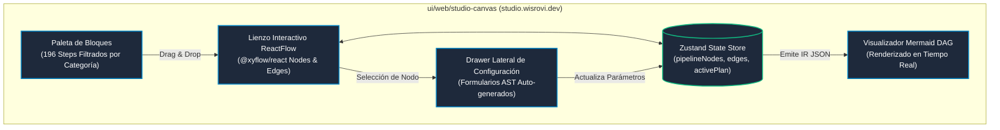

# WPipe Canvas UI & Web Frontend Architecture

La capa de presentación visual (`ui/web/`) está construida con React 19, TypeScript y Tailwind CSS, y se despliega como SPAs estáticas de alto rendimiento en Cloudflare Pages.



---

## 1. Aplicaciones Web del Ecosistema

| Proyecto | Directorio | Dominio en Producción | Función Principal |
|---|---|---|---|
| **Studio Canvas** | `ui/web/studio-canvas/` | `https://studio.wisrovi.dev` | Diseñador visual drag-and-drop de pipelines. Permite exportar a ZIP, ver diagramas Mermaid y probar flujos. |
| **SuperAdmin** | `ui/web/superadmin/` | `https://admin.wisrovi.dev` | Consola maestra de gestión de clientes, licencias, auditoría y métricas, protegida por 2FA OTP. |
| **Client Portal** | `ui/web/client-portal/` | `https://portal.wisrovi.dev` | Portal autoservicio donde los compradores consultan sus claves de licencia, nodos activos y descargan el engine. |

---

## 2. Componentes Clave del Canvas (`ui/web/studio-canvas/`)

1. **`CustomNode.tsx`**:
   - Renderiza los nodos con bordes de color dinámico según `StepOrigin`:
     - **Verde**: `catalog` (Steps oficiales de pip).
     - **Azul**: `user_imported` (Código `.py` subido por el usuario).
     - **Ámbar**: `described` (Pasos pendientes de síntesis por IA).
   - Handles de conexión de entrada/salida tipados para evitar conexiones cíclicas inválidas.

2. **`CatalogDrawer.tsx`**:
   - Búsqueda instantánea y filtrado de los 196 steps por categorías (`database`, `ai`, `security`, etc.).
   - Muestra descripción, requisitos y documentación directa del manifiesto `steps_catalog.json`.

3. **`InspectorPanel.tsx`**:
   - Genera dinámicamente campos de formulario basados en los parámetros `__init__` extraídos por el AST sin requerir llamadas costosas a LLM.

---

## 3. Construcción y Despliegue en Cloudflare Pages

Cada frontend web se compila con Vite de forma independiente:

```bash
# Compilar Studio Canvas
cd ui/web/studio-canvas
npm run build
npx wrangler pages deploy dist --project-name wpipe-studio

# Compilar SuperAdmin
cd ui/web/superadmin
npm run build
npx wrangler pages deploy dist --project-name wpipe-admin

# Compilar Client Portal
cd ui/web/client-portal
npm run build
npx wrangler pages deploy dist --project-name wpipe-portal
```
