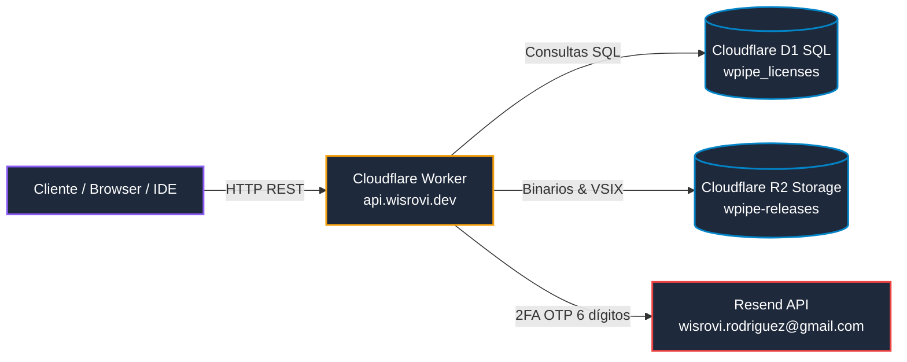

# WPipe Cloudflare Infrastructure & Edge Architecture

Esta skill documenta la capa Edge de WPipe Studio implementada en `edge/cloudfire/`, que ofrece costo 0 €/mes en reposo y alta disponibilidad global.



---

## 1. Topología de Endpoints Públicos y Privados

Todos los servicios responden bajo el dominio canónico `https://api.wisrovi.dev`:

### 1.1 Salud y Estado
- `GET /v1/health`: Estado del servicio (healthy), versión actual (`1.1.0`), estado de base de datos D1 y almacenamiento R2.

### 1.2 Licenciamiento y Activación de Máquinas
- `POST /v1/licenses/validate`: Valida una clave de licencia (`WPIPE-PRO-...`) y el fingerprint de hardware (`machine_id`).
- `POST /v1/licenses/activate`: Registra una nueva máquina activa bajo los límites del plan contratado (Free: 1 máquina, Pro: 3 máquinas, Enterprise: ilimitado).
- `POST /v1/licenses/heartbeat`: Renueva el lease criptográfico temporal de ejecución (válido por 7 días offline).

### 1.3 Super-Autenticación 2FA para Superadmin (`admin.wisrovi.dev`)
- `POST /v1/admin/auth/send-otp`:
  - Requiere el `master_secret` configurado en el Worker.
  - Genera un código criptográfico de un solo uso de 6 dígitos.
  - Envía el código mediante Resend al correo oficial del autor: `wisrovi.rodriguez@gmail.com`.
  - Código con tiempo de expiración estricto de 10 minutos.
- `POST /v1/admin/auth/verify-otp`:
  - Valida el código de 6 dígitos.
  - Genera una sesión administrativa HMAC-SHA256 con validez de 24 horas.

### 1.4 Webhooks de Facturación (Lemon Squeezy)
- `POST /v1/webhooks/lemonsqueezy`:
  - Valida la firma del payload mediante `X-Signature` y secreto compartido.
  - Eventos gestionados: `order_created`, `subscription_created`, `subscription_updated`, `subscription_cancelled`.
  - Crea o actualiza registros automáticamente en Cloudflare D1.

---

## 2. Esquema de Datos en Cloudflare D1 (`wpipe_licenses`)

La base de datos relacional serverless D1 contiene las siguientes tablas maestras:

1. **`licenses`**:
   - `id`: UUID primario.
   - `key`: Clave de licencia formateada (`WPIPE-PRO-XXXX-XXXX-XXXX`).
   - `plan`: Enum (`community`, `pro`, `enterprise`).
   - `max_machines`: Límite de nodos permitidos.
   - `max_blocks`: Límite de bloques concurrentes en el canvas (Free: 10, Pro: ilimitado).
   - `status`: Estado actual (`active`, `revoked`, `expired`).
   - `created_at`, `expires_at`.

2. **`activations`**:
   - `id`: UUID primario.
   - `license_id`: FK hacia `licenses.id`.
   - `machine_id`: Hash SHA-256 del hardware local.
   - `hostname`: Nombre de red del host.
   - `last_heartbeat`: Timestamp de última sincronización.

3. **`admin_otp`**:
   - `code`: Hash del OTP emitido.
   - `expires_at`: Timestamp de expiración.
   - `consumed`: Booleano para prevenir ataques de replay.

---

## 3. Despliegue y Administración con Wrangler

Para desplegar actualizaciones en la infraestructura Edge:

```bash
# Entrar al directorio
cd edge/cloudfire

# Probar en entorno local
npm run dev

# Desplegar Worker a producción
npx wrangler deploy

# Aplicar migraciones SQL a Cloudflare D1
npx wrangler d1 migrations apply wpipe_licenses --remote

# Subir artefactos al bucket R2 wpipe-releases
npx wrangler r2 object put wpipe-releases/extensions/wpipe-vscode-2.0.1.vsix --file ../../ui/extension/vscode/wpipe-vscode-2.0.1.vsix
```
