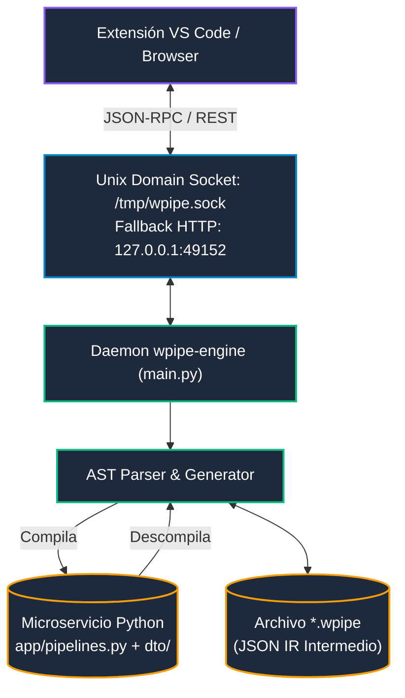

# WPipe Engine — Daemon Nativo Local & AST Compiler

`wpipe-engine` es el componente en segundo plano (`pipelines/engine/`) que ejecuta de forma nativa en la máquina del usuario o en el contenedor de desarrollo. Proporciona una interfaz IPC ultrarrápida para VS Code y el canvas web, además de compilar y descompilar pipelines bidireccionalmente.



---

## 1. Modos de Comunicación IPC

El demonio soporta dos canales de transporte simultáneos:

1. **Unix Domain Socket (Prioritario en Linux/macOS)**:
   - Ruta estándar: `/tmp/wpipe.sock`.
   - Latencia submilisegundo, seguro contra acceso de red no autorizado.
   - Usado principalmente por la extensión de VS Code.

2. **HTTP Localhost (Fallback y Canvas Web)**:
   - Puerto por defecto: `127.0.0.1:49152`.
   - Permite que aplicaciones web o contenedores aislados se comuniquen con el engine.

---

## 2. El Compilador AST Bidireccional

El núcleo de `wpipe-engine` (`pipelines/engine/wpipe_engine/core/compiler.py`) garantiza que el diseño visual y el código Python sean 100% equivalentes y sincronizados:

### 2.1 Compilación: `*.wpipe` (JSON) ➔ Python
- Lee los nodos y aristas del archivo intermedio IR.
- Identifica dependencias entre estados y construye el orden topológico del DAG.
- Genera:
  - `app/pipelines.py`: Instanciación de `Pipeline(steps=[...])`, decoradores `@step` y `@to_obj`.
  - `app/dto/`: Clases de contexto Pydantic independientes por cada estado (`dto/<step_name>_context.py`).
  - `app/states/`: Archivos Python individuales para cada nuevo estado diseñado.

### 2.2 Descompilación: Python ➔ `*.wpipe` (JSON)
- Parsea el AST de `app/pipelines.py` mediante la librería nativa de Python `ast`.
- Extrae la lista de pasos, sus configuraciones en `__init__` y sus tipos de entrada/salida.
- Reconstruye la representación visual de bloques y conexiones para el Custom Editor de VS Code.

---

## 3. Comandos Operativos y Pruebas

```bash
# Ejecutar suite de pruebas unitarias del engine
cd pipelines/engine
pytest tests/ -v

# Compilar binario nativo standalone con PyInstaller
./build.sh

# El binario compilado resultante se ubica en:
# pipelines/engine/dist/wpipe-engine
```
