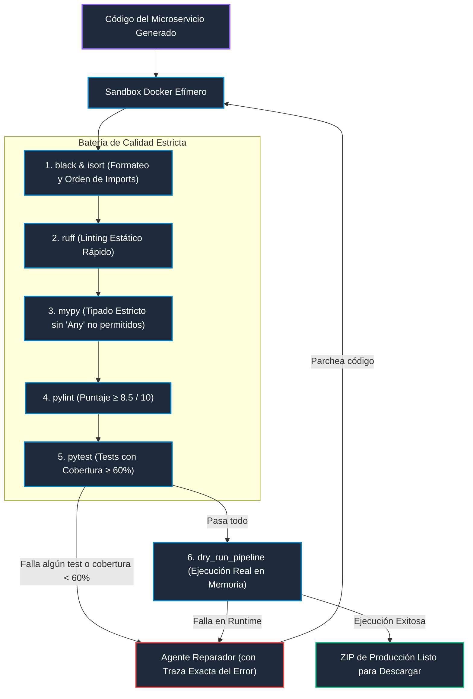

# WPipe QA Verification & Quality Gate Loop

El núcleo de confiabilidad de WPipe Studio reside en su **Loop de Verificación**. Ningún microservicio se exporta como ZIP ni se da por completado a menos que ejecute de punta a punta y supere la batería estricta de calidad en un sandbox Docker aislado.



---

## 1. El Gate de Calidad es Inviolable

- **Cero excepciones:** Si `pytest` falla, o la cobertura es inferior al 60%, el proceso aborta y **no se entrega ningún ZIP**.
- **Retroalimentación verbatim:** Cuando una herramienta de validación falla, el agente recibe la salida exacta del linter o compilador (archivo, línea, código de error) para realizar la corrección quirúrgica.
- **Límite de reintentos:** Se permiten un máximo de 5 iteraciones automáticas de reparación antes de solicitar intervención humana.

---

## 2. Los 6 Pasos de la Batería

| Paso | Herramienta | Objetivo | Criterio de Aprobación |
|---|---|---|---|
| **1** | `black` & `isort` | Consistencia estética y ordenación PEP 8 de imports. | Código limpio sin modificaciones requeridas (`--check`). |
| **2** | `ruff` | Detección ultrarrápida de variables no utilizadas, sintaxis y anti-patrones. | Cero errores nivel `E` y `F`. |
| **3** | `mypy` | Verificación estática de tipos en DTOs y firmas de estados. | Tipado consistente sin discrepancias. |
| **4** | `pylint` | Reglas avanzadas de complejidad ciclomática y buenas prácticas. | Puntuación estricta superior a 8.5/10. |
| **5** | `pytest` | Pruebas unitarias de estados, DTOs, API FastAPI y pipeline. | 100% de tests aprobados y `coverage >= 60%`. |
| **6** | `dry_run_pipeline` | Ejecución real en memoria con payloads de prueba sintéticos. | Finalización sin excepciones (`ProcessError`, `TimeoutError`). |

---

## 3. Ejecución de Tests en Docker

Para ejecutar las pruebas en el entorno aislado reproducible del proyecto:

```bash
# Ejecutar suite de pruebas unitarias y de integración dentro de Docker
./scripts/run_tests_docker.sh

# Ejecutar reporte de cobertura de código
./scripts/run_coverage.sh
```
