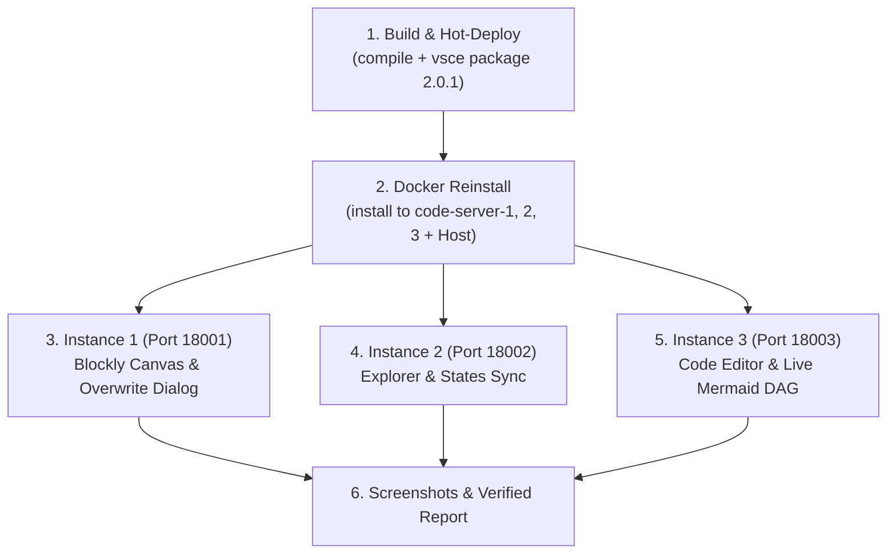

# WPipe Studio Testing Procedure (VS Code Extension & Tri-Instance Docker)

Standardized, end-to-end operational procedure for testing the official `wpipe.wpipe-vscode` extension across 3 live Docker `code-server` instances using Chrome DevTools MCP (`chrome-devtools`).

Trigger this procedure automatically whenever the user requests:
- *"prueba que funciona"*
- *"prueba la extensión"*
- *"test that it works"* / *"verify in browser"*
- Any request to test or validate the VS Code extension in the web environment.



---

## 1. Test Environment Topology

All 3 instances share the same workspace mounted at `/home/coder/workspace`:
Host path: `enviroment/code-server/app/` (mounted with user `william.rodriguez:william.rodriguez` / `1000:1000`).

| Instance | Local Port | Container Name | Testing Role |
|---|---|---|---|
| **Instance 1** | `http://localhost:18001/?folder=/home/coder/workspace` | `code-server-code-server-1-1` | **Blockly Canvas (`demo_pipeline.wpipe`)**: Block layout, Free plan quota badge (`Blocks 5 / 5 · Free`), lockout, Live AST code drawer, save button, and change overwrite modal (`Sobrescribir todos`). |
| **Instance 2** | `http://localhost:18002/?folder=/home/coder/workspace` | `code-server-code-server-2-1` | **Explorer & States Sync**: Verification of full generated microservice files (`app/`, `Dockerfile`, `Makefile`, `README.md`, `pyproject.toml`, `requirements.txt`) and `app/states/` (`ai_sentiment_step.py`, `base.py`). |
| **Instance 3** | `http://localhost:18003/?folder=/home/coder/workspace` | `code-server-code-server-3-1` | **Code Editor & DAG Preview (`app/pipelines.py`)**: WPipe CodeLens (`Run Pipeline`, `Preview DAG`, `Add Logic Block`) and Live Mermaid DAG split-view (`WPipe Analysis`). |

---

## 2. Compilation and Hot-Deployment Cycle

Whenever testing is requested or extension code is modified:

### Step 2.1: Compile TypeScript
```bash
npm --prefix ui/extension/vscode run compile
```

### Step 2.2: Package VSIX
```bash
(cd ui/extension/vscode && vsce package --no-git-tag-version --allow-missing-repository --no-dependencies -o wpipe-vscode-2.0.1.vsix)
```

### Step 2.3: Force Reinstall in All 3 Docker Containers
```bash
VSIX="ui/extension/vscode/wpipe-vscode-2.0.1.vsix"
for C in code-server-code-server-1-1 code-server-code-server-2-1 code-server-code-server-3-1; do
    docker cp "$VSIX" "$C":/tmp/wpipe-vscode-2.0.1.vsix
    docker exec "$C" code-server --uninstall-extension wisrovi.wpipe-vscode || true
    docker exec "$C" code-server --install-extension /tmp/wpipe-vscode-2.0.1.vsix --force
done
```

### Step 2.4: Force Reinstall on Host VS Code
```bash
code --install-extension ui/extension/vscode/wpipe-vscode-2.0.1.vsix --force
```

---

## 3. Chrome DevTools MCP Automated Testing Protocol

Using the lazy-loaded `chrome-devtools` MCP server tools:

### Phase 1: Instance 1 — Canvas & Overwrite Confirmation Dialog
1. Open or navigate to `http://localhost:18001/?folder=/home/coder/workspace`.
2. Ensure `demo_pipeline.wpipe` exists in `/home/coder/workspace` (copy from `contracts/ir/demo_pipeline.wpipe` if needed).
3. In the Activity Bar, click **WPipe** (`uid` of `WPipe: Step Registry`).
4. Click on `demo_pipeline.wpipe` under `🚀 Workspace Pipelines` to open the custom editor.
5. Verify inside the Webview iframe:
   - 5 blocks loaded (Trigger, HttpRequest, AISentimentStep, SaveDatabaseStep, Egress).
   - Badge shows `Blocks 5 / 5 · Free` and palette lockout.
   - Click `Fit` and `Code` button to verify split-view live AST generator.
6. Trigger save / overwrite test:
   - Modify a file like `/home/coder/workspace/app/main.py` with a test comment.
   - Click "Guardado ✓" (or trigger canvas save).
   - Verify the interactive notification appears:
     `⚠️ El archivo "app/main.py" ya existe con contenido distinto. ¿Deseas sobrescribirlo con la nueva configuración del pipeline?`
   - Click `Sobrescribir todos`.
   - Verify success notification: `💾 Pipeline guardado y microservicio compilado (Demo Pipeline)`.
7. Capture screenshot using `take_screenshot`.

### Phase 2: Instance 2 — Real-time Workspace & States Tree
1. Open or navigate to `http://localhost:18002/?folder=/home/coder/workspace`.
2. Inspect the File Explorer tree:
   - Verify generated files: `app/` (`dto/`, `states/`, `services/`, `utils/`, `config/`, `test/`), `docker-compose.yml`, `Dockerfile`, `Makefile`, `README.md`, `pyproject.toml`, `requirements.txt`.
3. Expand `app/states/`:
   - Verify `ai_sentiment_step.py` and `base.py` exist and are populated.

### Phase 3: Instance 3 — Python Code & Live Mermaid DAG
1. Open or navigate to `http://localhost:18003/?folder=/home/coder/workspace`.
2. Open `app/pipelines.py` in the Monaco editor.
3. Verify CodeLens actions appear:
   - ` Run Pipeline`
   - ` Preview DAG`
   - ` Add Logic Block`
4. Click `WPipe: Preview Pipeline DAG` (` Preview DAG`).
5. Verify split-view `WPipe Analysis` opens:
   - Metrics cards: `1 PIPELINE`, `3 ESTADOS TOTALES`, `O(N) COMPLEJIDAD TEÓRICA`.
   - SVG Mermaid Flowchart renders: `🚀 Iniciar Pipeline` ➔ `HttpRequest` ➔ `AISentimentStep` ➔ `SaveDatabaseStep` ➔ `🏁 Fin`.
6. Capture screenshot with `take_screenshot`.

---

## 4. Key Technologies and Libraries
- **VS Code Extension API**: Custom Editor Provider (`*.wpipe`), TreeDataProvider (Step Registry), Webview API.
- **Chrome DevTools Protocol (MCP)**: Headless browser control, DOM inspection, evaluate_script, screenshot capture.
- **Docker & code-server**: 3 ephemeral browser IDE containers (`codercom/code-server:4.16.1-ubuntu`).
- **WPipe & Mermaid.js**: Python AST compilation and real-time DAG graph visualization.
