# ROADMAP.md — WPipe Studio

> Hoja de ruta estratégica, estado de hitos consolidados y pendientes operativos para producción.

```mermaid
flowchart LR
    classDef done fill:#064e3b,stroke:#10b981,stroke-width:2px,color:#fff;
    classDef pending fill:#78350f,stroke:#f59e0b,stroke-width:2px,color:#fff;
    classDef next fill:#1e1b4b,stroke:#6366f1,stroke-width:2px,color:#fff;

    Hito1["1. Monorepo & Taxonomía Canónica<br/>(pipelines, ui, edge, contracts)"]:::done
    Hito2["2. Edge Cloudflare & 2FA OTP<br/>(api, studio, admin, portal)"]:::done
    Hito3["3. Extensión v2.0.1 en Open VSX<br/>(reemplaza v1.0.5)"]:::done
    Hito4["4. Documentación & Skills Agénticas<br/>(.agents/skills/ + AGENTS.md)"]:::done
    Pendiente1["5. Publicación en VS Code Marketplace<br/>(Requiere PAT Azure DevOps)"]:::pending
    Futuro["6. Marketplace Comunitario de Steps<br/>(wpipe-plugins)"]:::next

    Hito1 --> Hito2 --> Hito3 --> Hito4 --> Pendiente1 --> Futuro
```



---

## 📌 Estado Actual del Proyecto

| Área | Estado | Detalle |
|---|---|---|
| **Estructura del Monorepo** | ✅ Completado | Taxonomía estandarizada en `pipelines/`, `ui/`, `edge/`, `contracts/`, `scripts/`, `docs/`, `infra/`, `legacy/`. |
| **Infraestructura Edge (Cloudflare)** | ✅ Completado | Worker `api.wisrovi.dev` (D1 DB, R2 releases), frontends en Cloudflare Pages (`studio.wisrovi.dev`, `admin.wisrovi.dev`, `portal.wisrovi.dev`). |
| **Seguridad 2FA / OTP** | ✅ Completado | Consola SuperAdmin blindada con Master Key + OTP de 6 dígitos enviado por correo a `wisrovi.rodriguez@gmail.com`. |
| **Registro Open VSX** | ✅ Completado | `wpipe.wpipe-vscode` versión **`2.0.1`** publicada y activa como `latest` (para Cursor, VSCodium, Gitpod, code-server). |
| **Documentación & Skills de Agentes** | ✅ Completado | 6 skills exhaustivas en `.agents/skills/` con diagramas Mermaid y contexto persistente en `AGENTS.md`. |
| **Microsoft VS Code Marketplace** | ⏳ Pendiente | Pendiente de publicar con PAT en `marketplace.visualstudio.com`. |

---

## 🚀 Tareas Pendientes y Guía Operativa

### 1. Publicación de la Extensión en Microsoft Visual Studio Marketplace

Para que la versión **2.0.1** aparezca directamente al buscar `WPipe` dentro de la aplicación oficial de Microsoft Visual Studio Code:

#### Paso 1.1: Generar el Personal Access Token (PAT) en Azure DevOps
1. Iniciar sesión en [Azure DevOps](https://dev.azure.com/).
2. Ir a la configuración de usuario (arriba a la derecha) ➔ **Personal access tokens**.
3. Crear un nuevo token con:
   - **Organization:** *All accessible organizations* (o la organización asociada al publisher `wpipe`).
   - **Scopes:** Seleccionar **Custom defined** ➔ desplegar **Marketplace** ➔ marcar **Manage**.
4. Copiar el token generado.

#### Paso 1.2: Publicar la Extensión Oficial
Ejecutar el comando de publicación con `vsce`:

```bash
# Situarse en la carpeta de la extensión
cd ui/extension/vscode

# Publicar en el Marketplace oficial de Microsoft
vsce publish -p <TU_TOKEN_PAT_AZURE_DEVOPS>
```

---

### 2. Instalación Local Inmediata (Alternativa Offline sin Token)

Mientras se obtiene el token, se puede instalar y usar la versión 2.0.1 directamente en el VS Code del host:

```bash
code --install-extension ui/extension/vscode/wpipe-vscode-2.0.1.vsix --force
```

O desde la interfaz gráfica de VS Code:
1. Abrir la pestaña de **Extensiones** (`Ctrl + Shift + X`).
2. Hacer clic en el menú contextual de los tres puntos (`...`) en la esquina superior derecha del panel de extensiones.
3. Seleccionar **Install from VSIX...**
4. Seleccionar el archivo [wpipe-vscode-2.0.1.vsix](file:///home/wisrovi/Documents/w_libraries/wpipe_os/wpipe-studio/ui/extension/vscode/wpipe-vscode-2.0.1.vsix).

---

### 3. Siguientes Pasos del Roadmap Técnico

- [ ] **Merge de la Rama `DEV-WSRV/QA` a `main`:** Crear Pull Request o merge directo una vez validada la versión en producción.
- [ ] **Marketplace Comunitario de Steps (`wpipe-plugins`):** Integrar soporte dinámico en el canvas para importar paquetes comunitarios verificados vía PyPI.
- [ ] **Telemetría y Métricas en SuperAdmin:** Añadir gráficos en tiempo de ejecución de las ejecuciones de `dry_run_pipeline` y consumo de API.
