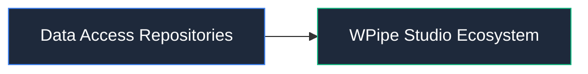

# 📦 Data Access Repositories

Capa de acceso a datos y persistencia transaccional con PostgreSQL y SQLite.

## 📌 Arquitectura & Flujo

## 🛠️ Rol en el Sistema
Este módulo forma parte de la arquitectura modular de **WPipe Studio**, garantizando separación de responsabilidades, tipado estricto y mantenibilidad.
