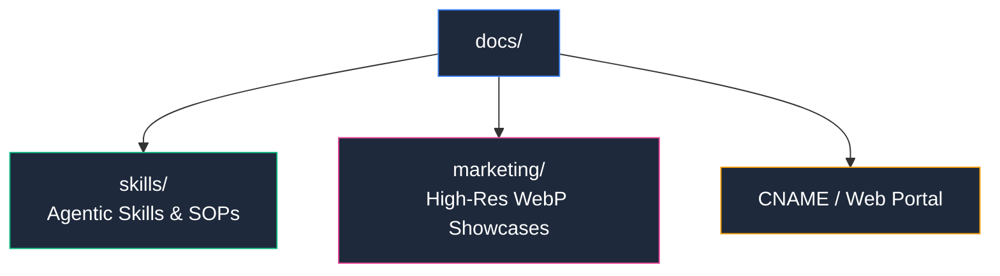

# 📚 Documentación Técnica & Marketing — WPipe Studio

Directorio central de especificaciones de producto, material gráfico oficial y guías metodológicas.

## 📌 Estructura
- `skills/`: Habilidades y especificaciones operativas para agentes inteligentes (ej. pruebas automatizadas de la extensión en VS Code Web).
- `marketing/`: Capturas y composiciones oficiales en alta resolución (`.webp`) del canvas visual y del entorno IDE integrado.
- `CNAME`: Registro canónico de dominio para el portal de documentación.

