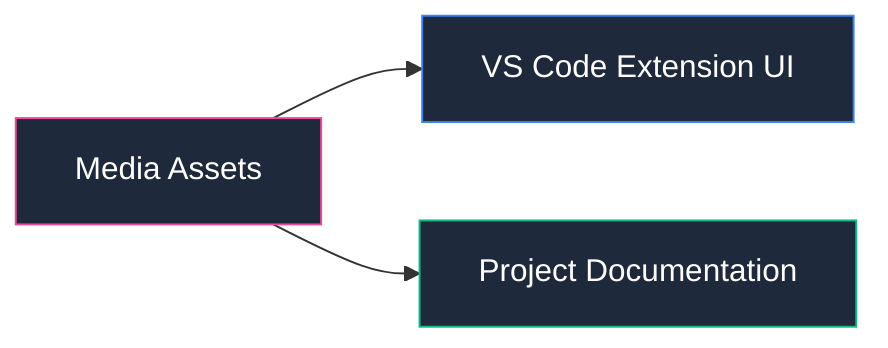

# 🎨 Media & Visual Assets

Recursos visuales, capturas y assets multimedia de **WPipe Studio**.

## 📌 Contenido
Almacena recursos gráficos utilizados en la documentación de la extensión de VS Code, interfaces de usuario y demostraciones públicas del ecosistema.

