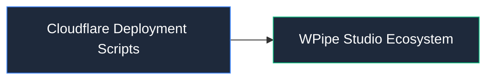

# 📦 Cloudflare Deployment Scripts

Scripts de automatización y despliegue en Cloudflare Workers.

## 📌 Arquitectura & Flujo

## 🛠️ Rol en el Sistema
Este módulo forma parte de la arquitectura modular de **WPipe Studio**, garantizando separación de responsabilidades, tipado estricto y mantenibilidad.
