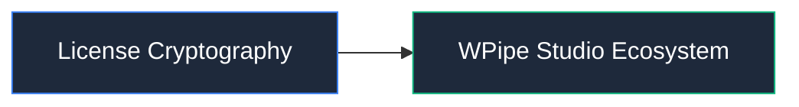

# 📦 License Cryptography

Generación de tokens firmados, verificación de hash y claves.

## 📌 Arquitectura & Flujo

## 🛠️ Rol en el Sistema
Este módulo forma parte de la arquitectura modular de **WPipe Studio**, garantizando separación de responsabilidades, tipado estricto y mantenibilidad.
