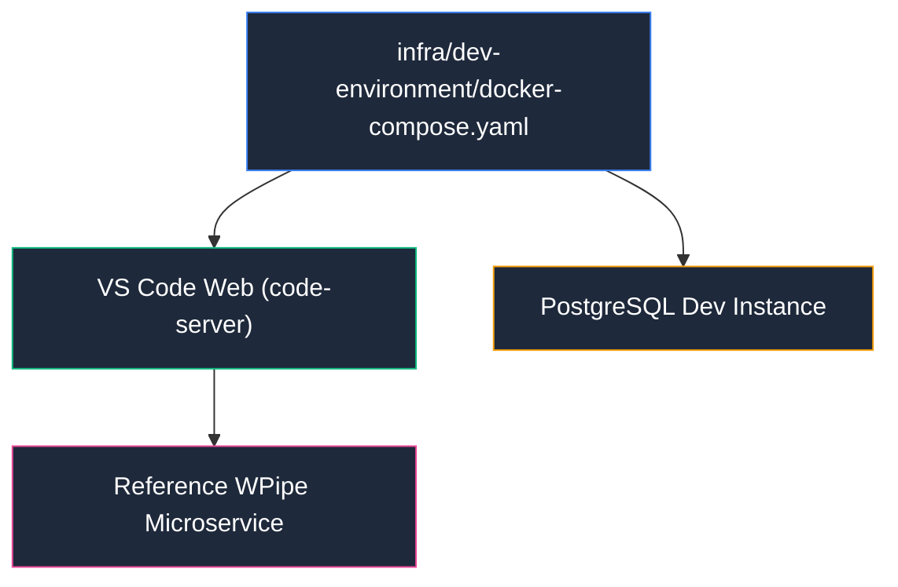

# 🏗️ Infrastructure & Local Environments — WPipe Studio

Configuración de contenedores Docker, compose files y entornos de desarrollo web integrados.

## 📌 Arquitectura & Flujo

## 📁 Subdirectorios
- `dev-environment/`: Contenedor y configuración de `code-server` para pruebas integradas de la extensión en navegador.
