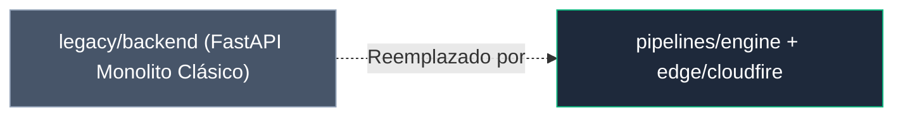

# 🏛️ Legacy Archives — WPipe Studio

Módulos históricos y prototipos archivados que han sido reemplazados por la arquitectura local-first desacoplada (`pipelines/engine`).

> [!NOTE]
> Estos componentes se mantienen únicamente con fines de auditoría histórica y compatibilidad retrospectiva.
