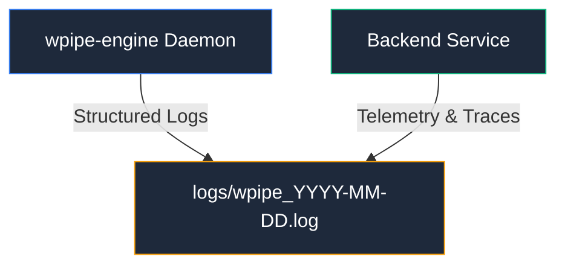

# 📝 Execution Logs

Directorio de registros de ejecución del daemon, workers y procesos de backend de **WPipe Studio**.

## 📌 Gestión de Logs
Los registros generados en este directorio permiten el diagnóstico de incidentes, trazas de depuración de pipelines y auditoría de conexión de sockets IPC.

> [!NOTE]
> Los archivos de log con marcas de tiempo (`*.log`) son temporales y están ignorados por `.gitignore`.
