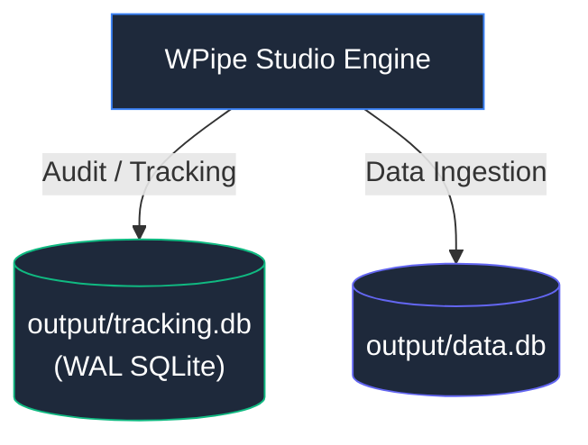

# 📦 Output Artifacts & Databases

Directorio reservado para la persistencia efímera y bases de datos generadas por el runtime durante pruebas y benchmarks.

## 📌 Contexto de Datos
Contiene bases de datos locales SQLite utilizadas por el subsistema de telemetría, auditoría de pasos y almacenamiento transitorio.

> [!WARNING]
> Los archivos binarios de base de datos (`.db`, `.sqlite`, `.sqlite-wal`) están excluidos del control de versiones por `.gitignore`.
