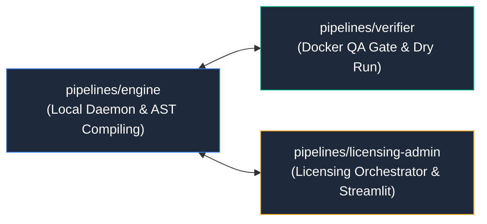

# ⚡ WPipe Microservices & Pipelines

Directorio raíz que agrupa todos los microservicios del sistema impulsados y orquestados nativamente con **WPipe**.

## 📌 Arquitectura & Flujo

## 🛠️ Filosofía WPipe
Cada servicio en este directorio está modelado como un pipeline desacoplado, con un Context Pydantic por estado, contratos estrictos y ejecución modular libre de monolitos.
