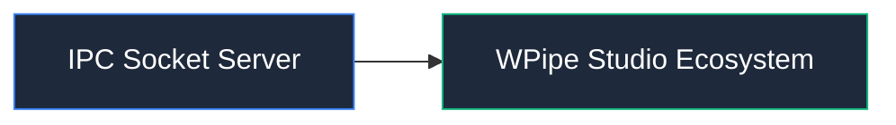

# 📦 IPC Socket Server

Comunicación entre el daemon del motor y la extensión de VS Code vía sockets IPC/HTTP.

## 📌 Arquitectura & Flujo

## 🛠️ Rol en el Sistema
Este módulo forma parte de la arquitectura modular de **WPipe Studio**, garantizando separación de responsabilidades, tipado estricto y mantenibilidad.
