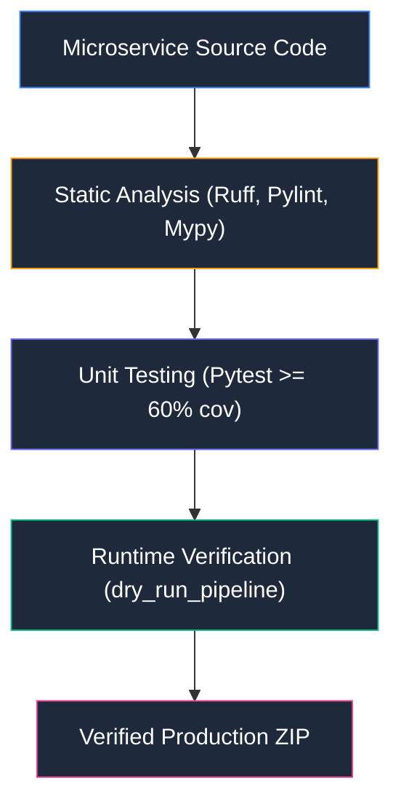

# 📦 WPipe Verifier Pipeline

Microservicio orquestador de la batería de calidad, auditoría estática y validación en tiempo de ejecución (`dry_run_pipeline`).

## 📌 Arquitectura & Flujo

## 🛠️ Rol en el Sistema
Garantiza el **criterio de éxito único e inviolable** de WPipe Studio: ningún microservicio se descarga si no pasa la batería de calidad y ejecuta de punta a punta.
