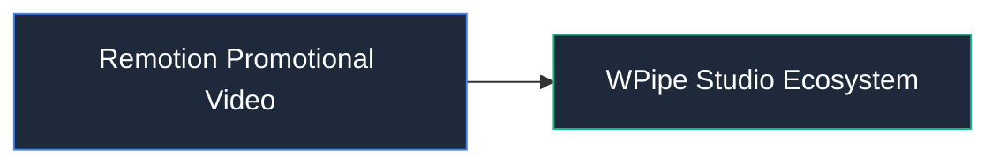

# 📦 Remotion Promotional Video

Proyecto Remotion en TypeScript/React para generación de videos promocionales automatizados.

## 📌 Arquitectura & Flujo

## 🛠️ Rol en el Sistema
Este módulo forma parte de la arquitectura modular de **WPipe Studio**, garantizando separación de responsabilidades, tipado estricto y mantenibilidad.
