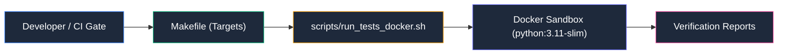

# 🛠️ Automation & Build Scripts — WPipe Studio

Scripts de automatización operativa, ejecución de tests en sandbox Docker y generación de reportes de cobertura.

## 📌 Arquitectura & Flujo

## 📁 Scripts Incluidos
- `run_tests_docker.sh`: Ejecuta la batería completa de pruebas unitarias en un contenedor Docker aislado.
- `run_coverage.sh`: Genera reportes de cobertura de código.
