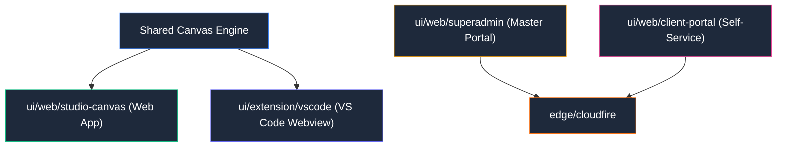

# 🖥️ Interfaces de Usuario (Frontends) — WPipe Studio

Colección de interfaces visuales del ecosistema, diseñadas con un núcleo compartido de canvas visual interactivo.

## 📌 Arquitectura & Flujo

## 📁 Componentes UI
- `web/studio-canvas`: Aplicación web interactiva para dibujar pipelines con bloques tipo Scratch / n8n.
- `web/superadmin`: Panel maestro de administración de clientes, licencias y métricas.
- `web/client-portal`: Portal cliente para activación y consulta de claves.
- `extension/vscode`: Extensión de VS Code con Custom Editor nativo (`*.wpipe`).
